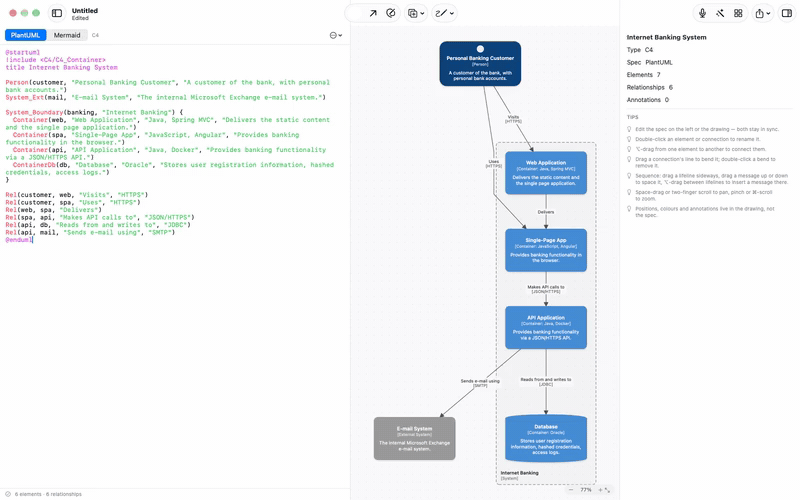
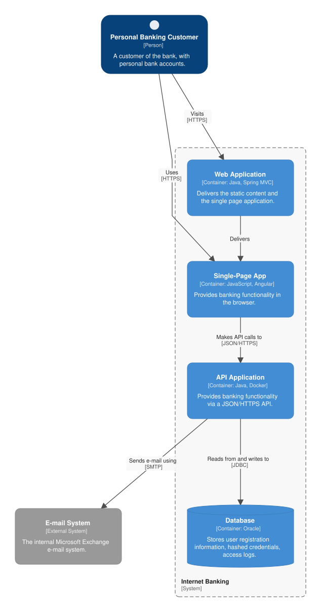
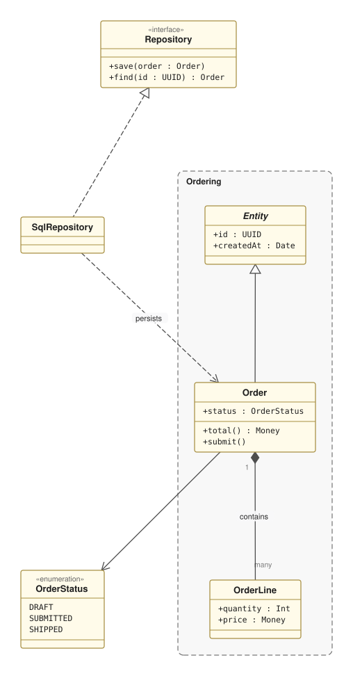
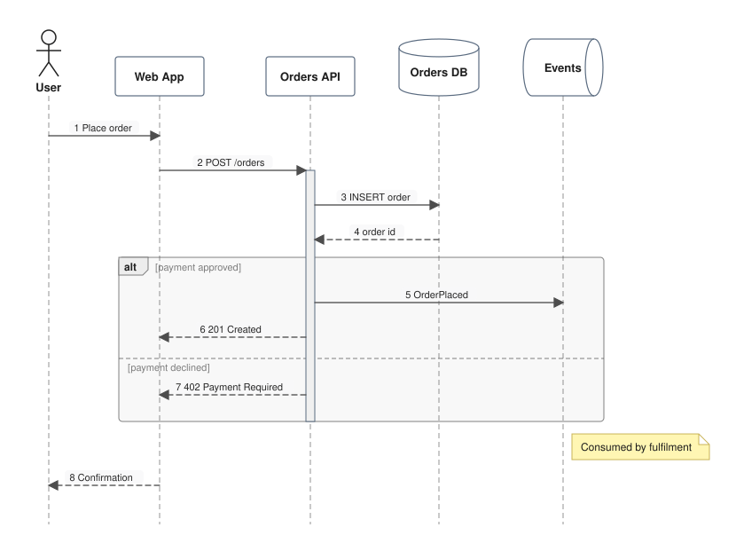
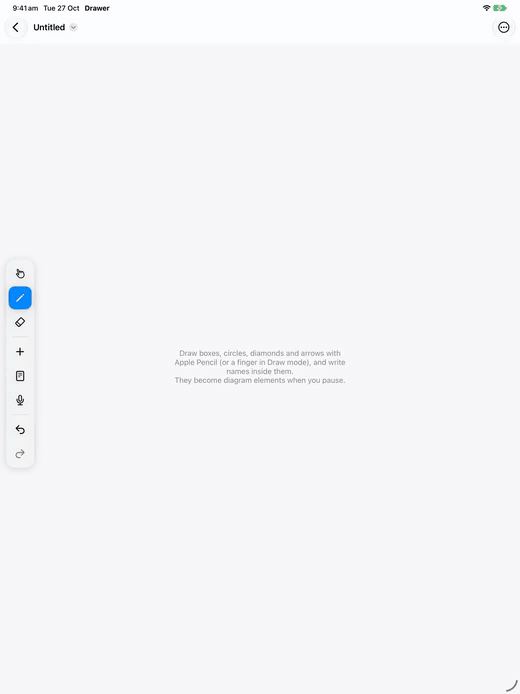

<div align="center">


# Drawer

**Sketch your architecture. Get real PlantUML and Mermaid.**

C4, UML class, ER, sequence and flow diagrams for the Mac and iPad, where the spec and the drawing are the same thing —
edit either one and the other follows.

[](https://github.com/romadinov/drawer/releases/latest)




**▶ Narrated demos: [Mac (1:04)](https://github.com/romadinov/drawer/releases/download/v0.3.0/Drawer-mac-demo.mp4) · [iPad (1:40)](https://github.com/romadinov/drawer/releases/download/v0.3.0/Drawer-demo.mp4)**

</div>

---

## Why Drawer

Diagram tools make you choose: draw boxes by hand and lose the text, or write PlantUML and fight the layout.
Drawer keeps **both**. The spec is the source of truth for *what* is in the diagram; the drawing owns *where* things
are and how they look. Type in the spec and the canvas updates. Drag, sketch or rename on the canvas and Drawer
edits the spec for you — surgically, keeping your formatting and comments.

## Sketch it

Draw with Apple Pencil, a finger, a mouse or a trackpad.

- **Shapes become elements.** Boxes, circles, diamonds and stick figures turn into the right element for the diagram:
  containers and people in C4, classes in UML, entities in ER, participants in sequence diagrams.
- **It asks when it isn't sure.** A box could be a container, a system or a database — Drawer asks right next to the
  shape, then goes straight to naming it.
- **Handwriting becomes titles and labels.** Write inside a shape to name it, beside an arrow to label it.
- **Lines become relationships.** Draw from one element to another; in sequence diagrams the message lands at the
  height you drew it.
- **Nesting by drawing.** Draw around elements to group them (C4 boundary, subgraph, package); draw inside a
  container to put components in it.
- **Nothing is lost.** Anything that isn't recognised stays as ink.

## Write it

- **PlantUML and Mermaid**, side by side with the canvas, convertible either way.
- **Autocompletion** for keywords, element names and arrows — the right ones for the diagram type.
- **Selections sync both ways**: click an element to find its line, put the caret on a line to select the element.

## Editable images, like draw.io

PNG and SVG exports carry the editable diagram inside them. Put `architecture.svg` in your README, open it in Drawer
later, change it, and it saves back to the same file.

<table>
<tr>
<td width="44%"></td>
<td width="28%"></td>
<td width="28%"></td>
</tr>
<tr>
<td align="center"><sub>C4 container (PlantUML)</sub></td>
<td align="center"><sub>UML class (PlantUML)</sub></td>
<td align="center"><sub>Sequence (PlantUML)</sub></td>
</tr>
</table>

<sub>These three SVGs were exported by Drawer — open any of them in Drawer to keep editing.</sub>

## On the iPad



The companion app opens the same `.drawer` files from Files and iCloud Drive.

- **Apple Pencil first** — the Pencil always draws, fingers select and pan; an eraser, and Pencil double-tap to switch tools.
- **Floating tool palette** with an Add palette per diagram type.
- **Spec side by side**, with suggestions above the keyboard.
- **Share** diagrams as editable PNG or SVG.

<br clear="right">

## And more

- **Voice commands** — "add a database called orders", "connect web app to orders labelled reads",
  "API calls payments", "make orders a queue", "undo", "auto layout".
- **Copy and paste** — ⌘C puts the selection on the clipboard as PNG, SVG and PDF *and* as a diagram; paste a
  diagram (or an image exported by Drawer) into another and it merges, converting between PlantUML and Mermaid.
- **Auto layout** that respects groups and routes around obstacles, plus manual waypoints, routing styles,
  colours and free-form annotations that live only in the drawing.
- **Sequence diagrams** with activations, `alt`/`loop`/`opt`/`par` fragments, notes, dividers and autonumbering;
  drag a lifeline sideways or a message up and down.

## Install

**Mac:** download `Drawer-0.3.1.dmg` from the [latest release](https://github.com/romadinov/drawer/releases/latest),
open it and drag Drawer to Applications. Requires macOS 27 on Apple silicon. The app is signed but not notarized, so
the first time right-click it and choose **Open**.

**iPad / iPhone:** build from source (below) with your own signing team.

## Build from source

Requires Xcode 27 and [XcodeGen](https://github.com/yonaskolb/XcodeGen).

```bash
xcodegen generate
open Drawer.xcodeproj          # schemes: Drawer (macOS), DrawerMobile (iOS/iPadOS)

swift test --package-path Core # the diagram engine's test suite
```

For a device, set your team under **Signing & Capabilities** of the `DrawerMobile` target (or `DEVELOPMENT_TEAM` in
`project.yml`).

### Command line

The Mac app also works headless, which is handy for docs pipelines:

```bash
Drawer.app/Contents/MacOS/Drawer --export diagram.drawer diagram.svg   # or .png / .pdf; PNG and SVG stay editable
Drawer.app/Contents/MacOS/Drawer --export diagram.png  diagram.pdf     # inputs can be exported images too
Drawer.app/Contents/MacOS/Drawer --ink sketch.drawer recognised.drawer # recognise ink in a file
```

## How it's built

| Folder | What's in it |
|---|---|
| `Core/` | **DrawerCore**, a Swift package with no UI: PlantUML and Mermaid parsers with source spans, the minimal-diff spec editor, layout and geometry, ink recognition, voice commands, completion, and embedding diagrams in PNG/SVG. |
| `Shared/` | The renderer (Core Graphics, with an SVG back end), the document, handwriting reading (Vision) and speech — used by both apps. |
| `App/` | The macOS app (AppKit canvas, spec editor, inspector). |
| `Mobile/` | The iPad/iPhone app and its UI tests, including the script that records the demo above. |

Both demo videos are reproducible. On iPad, `Mobile/UITests/DemoTests.swift` drives the app scene by scene, timed to
the narration in `docs/demo/narration.json`, and `docs/demo/record.sh` records it. On the Mac, a debug build run with
`--record-demo DIR` plays `App/Sources/MacDemo.swift`, timed to `docs/demo/mac-narration.json`, and records its own
windows frame by frame.
